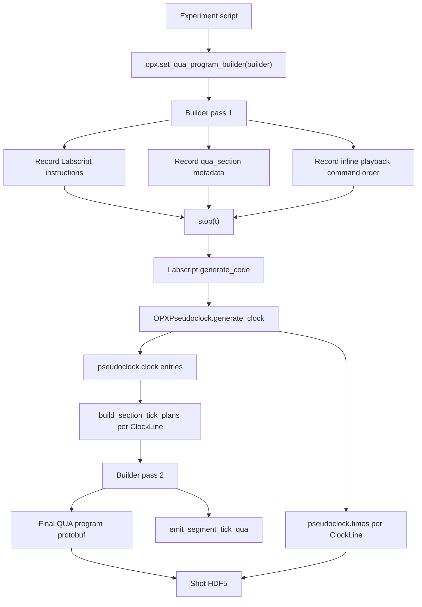
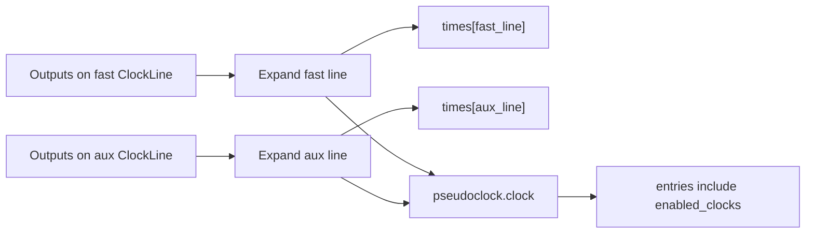
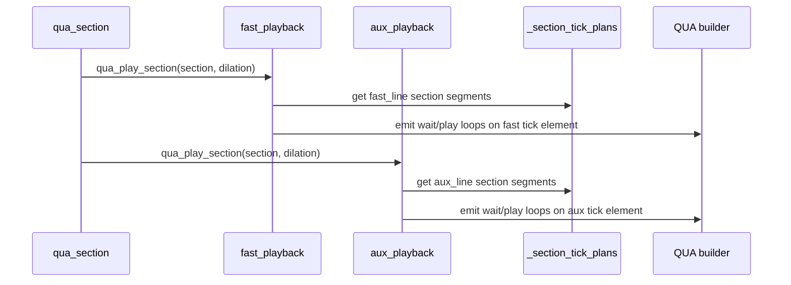
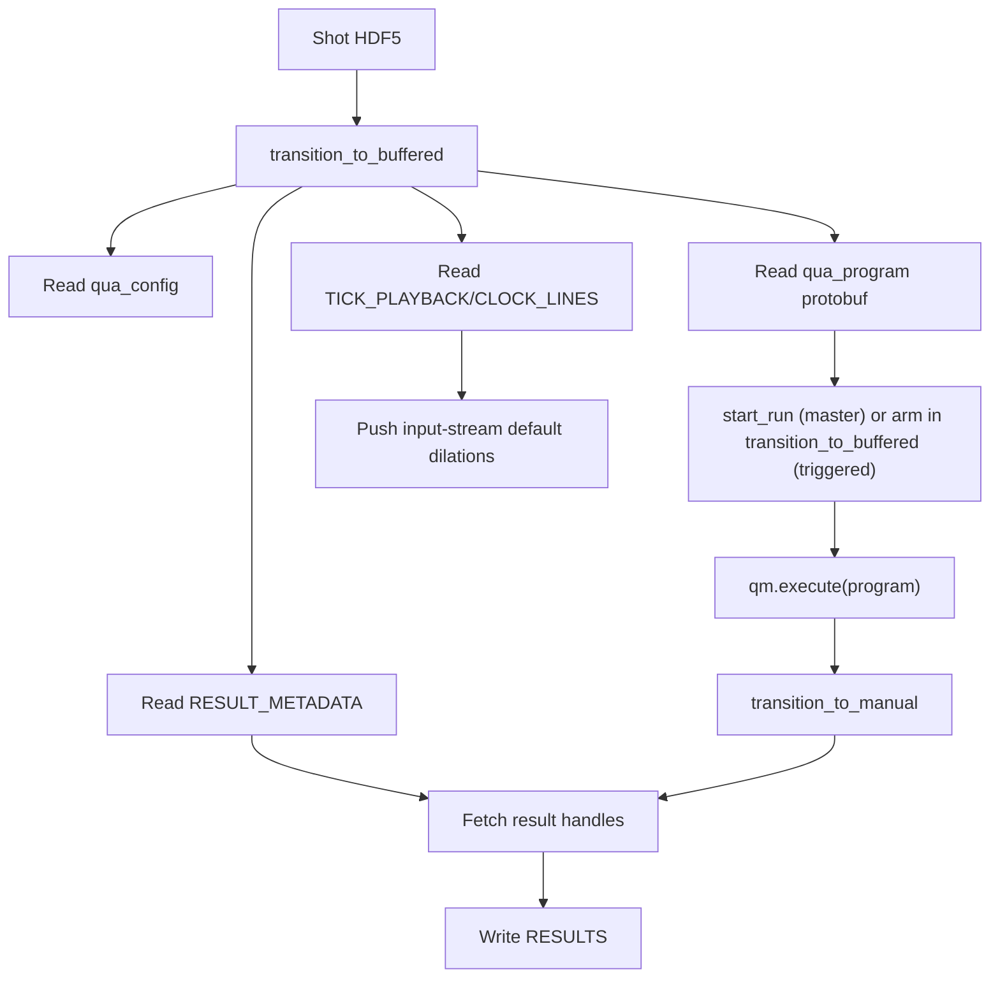

# OPX Driver Developer Notes

This document explains how the OPX Labscript device turns an experiment script
into the final QUA program that BLACS executes, including how Labscript
pseudoclock ticks are compiled and inserted into QUA.

The user-facing setup guide is `README.md`. This file focuses on driver data
flow and implementation boundaries.

## Deployment Roles (Same `OPX` Class)

| Role | Labscript wiring | Compile-time APIs | BLACS execution |
|------|------------------|-------------------|-----------------|
| Master pseudoclock | No `trigger_device`; `is_master_pseudoclock=True` in shot HDF5 | Tick playback, `set_qua_program_builder`, single stored `qua_program` | `execute` or `precompiled_program_id`; job starts in `start_run()` |
| Triggered OPX | `trigger_device` set; secondary pseudoclock in Labscript | one program via `set_qua_program_builder` + `triggered_segment(...)` (`precompiled_program_id`) | `precompiled_program_id` (one job, multiple triggers per shot); job armed in `transition_to_buffered()` |

Both roles share `OPX.generate_code()` HDF5 layout,
`OPXWorker`, and result export. Inline tick playback is master-role only.

## Main Objects

- `OPX` in `user_devices/opx/labscript_devices.py`: Labscript device
  that owns an `OPXPseudoclock`, one or more `ClockLine`s, QUA config/program
  metadata, playback configs, and result export metadata.
- `OPXPseudoclock`: custom Labscript `Pseudoclock` subclass. It allows multiple
  `ClockLine` children and expands each line independently.
- `OPXInlineTickPlayback`: experiment-facing helper returned by
  `opx.enable_inline_tick_playback(...)`. Each instance is bound to exactly one
  Labscript clock line and one QUA tick element.
- `qua_section()` in `user_devices/opx/qua_tick_programs.py`: records nominal section boundaries
  and calls one or more playback helpers inside a `qua.program()`.
- `tick_segment_compile.py`: converts Labscript clock metadata into compact
  `TickSegment` objects and emits QUA `wait`/`play` loops.
- `OPXWorker` in `blacs_workers.py`: runtime reader/executor/exporter. Delegates
  job lifecycle to `OpxJobRunner` / `OpxShotLoader` and job-status checks to
  `opx_job_status.py` so the same worker supports QOP 2.x (`RunningQmJob`) and
  QOP 3.x (`JobApi`).
- `OpxHeadlessRunner` in `opx_headless_runner.py`: replays shot HDF5 without
  BLACS for unit tests and CI (not a hardware substitute).

## Apparatus QM Config

Reference experiments keep hardware-specific QM dictionaries in
`labscriptlib.opx_apparatus.config_opx` (master),
`config_opx_queued_triggered` (triggered secondary), and
`config_opx_manual` (`experiment_manual.py`) rather than inline in
each experiment script. Experiments import shared constants and assign one of
the pre-built configs (`CONFIG_OPX1000`, `CONFIG_OPX1000_QUEUED_MASTER`,
`CONFIG_OPX1000_MANUAL`, and so on).
Driver code treats `opx.qm_config` as an opaque dict; OPX+ vs OPX1000
differences are an apparatus concern.

## Compile Pipeline Overview

The important detail is that the experiment's QUA builder is executed twice.
The first pass records Labscript instructions. The second pass emits the final
QUA tick replay code after Labscript has compiled the pseudoclock.



## Pass 1: Registration Without Tick Emission

`OPX.set_qua_program_builder(builder)` prepares the device for a registration
pass:

```python
self._qua_program_builder = builder
self._emit_segment_tick_qua = False
self._section_tick_plans = {}
self._playback_sections.clear()
self._inline_tick_commands[...] = []
builder()
```

During this pass:

- `start()`, `stop()`, `DigitalOut.go_high()`, fake voltage ramps, and similar
  Labscript calls record normal Labscript output instructions.
- `qua_section()` appends `PlaybackSection` records to `opx._playback_sections`.
- `OPXInlineTickPlayback.qua_play_section()` calls
  `opx._register_inline_tick_command(...)`, but returns before emitting QUA tick
  waits or plays because `_emit_segment_tick_qua` is `False`.
- QUA measurement and stream code is still built, but this pass is not the QUA
  program stored for runtime.

This pass is needed because Labscript's pseudoclock data does not exist until
after all output instructions have been recorded.

## Labscript Pseudoclock Compile

When the experiment calls `stop(t)`, Labscript calls
`OPX.generate_code(hdf5_file)`. The OPX implementation first lets the Labscript
base classes compile the pseudoclock:

```python
PseudoclockDevice.generate_code(self, hdf5_file)
```

That calls `OPXPseudoclock.generate_clock()`.

### Independent Clock-Line Expansion

`OPXPseudoclock.expand_change_times(...)` is customized for this device. The
base Labscript pseudoclock uses one maximum ramp rate across all clock lines
that are active at the same time. The OPX implementation expands each
`ClockLine` independently:

- each line uses only the outputs parented to that line,
- each line applies its own `clock_limit`,
- each line gets its own `pseudoclock.times[clock_line]`,
- `pseudoclock.clock` entries retain `enabled_clocks`, so later segment
  compilation can filter by line.



This is what lets a 100 Hz ramp on one line coexist with a 40 Hz or 50 Hz ramp
on another line without the slower line capping the faster one.

## Segment Planning

After Labscript has produced `pseudoclock.clock`, `OPX` builds segment plans:

```python
section_tick_plans[clock_line_name] = build_section_tick_plans(
    self.pseudoclock.clock,
    clock_line,
    list(self._playback_sections),
    stop_time,
    list(self._inline_tick_commands.get(clock_line_name, [])),
    default_time_dilation=tick_playback.default_time_dilation,
    control_mode=tick_playback.control_mode,
    clock_cycle_s=OPX_CLOCK_CYCLE_S,
)
```

`build_tick_segments_from_clock(...)` filters each `pseudoclock.clock` entry by
`enabled_clocks`. The output is line-local:

```text
_section_tick_plans:
  <clock_line_name>:
    <section_name>:
      TickSegment(start_s, reps, step_cycles, first_wait_cycles)
```

Each `TickSegment` describes a compact run of equally spaced ticks. Dense ramps
therefore become one QUA loop rather than hundreds or thousands of unrolled
`play()` calls.

## Pass 2: Final QUA Program Emission

Before running the builder a second time, `OPX` snapshots Labscript output state:

```python
saved_outputs = self._snapshot_output_state()
try:
    for output in saved_outputs:
        output.instructions = {}
        output.ramp_limits = []
    builder()
finally:
    self._restore_output_state(saved_outputs)
```

The temporary tables keep replayed ramps separate from the clock-quantised
instructions and ramp limits of pass 1. Otherwise floating-point differences
such as `0.825` versus `0.8250000000000001` can cause a false overlap error.
The compiled output state is restored even if the builder raises. In pass 2,
`_emit_segment_tick_qua` is `True`, so every playback helper call emits QUA code.

For a section:

```python
with qua_section(
    opx=opx,
    name="dual_ramp",
    t=t,
    duration_s=2.2,
    playback=[fast_playback, aux_playback],
):
    ...
```

the helper records one section, then calls:

```python
fast_playback.qua_play_section("dual_ramp", time_dilation)
aux_playback.qua_play_section("dual_ramp", time_dilation)
```

Each playback helper:

1. registers its command order for HDF5 debugging,
2. retrieves `self.opx._section_tick_plans[self.clock_line_name][section_name]`,
3. calls `emit_segment_tick_qua(...)` or the precomputed-step variant,
4. emits QUA waits and tick plays on its own QUA tick element.



## What Gets Emitted In QUA

For fixed time dilation, tick waits are constants where possible:

```python
with qua.for_(tick_index, 0, tick_index < reps, tick_index + 1):
    with qua.if_(tick_index > 0):
        qua.wait(step_cycles_scaled_minus_pulse, tick_element)
    qua.play(tick_operation, tick_element)
```

For runtime dilation, the emitted code computes scaled waits from a QUA fixed
variable:

```python
qua.assign(
    interval_cycles,
    qua.Cast.mul_int_by_fixed(step_cycles, time_dilation) - pulse_cycles,
)
with qua.for_(tick_index, 0, tick_index < reps, tick_index + 1):
    with qua.if_(tick_index > 0):
        with qua.if_(interval_cycles >= 4):
            qua.wait(interval_cycles, tick_element)
    qua.play(tick_operation, tick_element)
```

The implementation deliberately computes repeated runtime expressions outside
dense loops when possible. This keeps QOP compile size under control.

## Important QUA Loop Rule

Use `with qua.for_(...)` for repeated runtime QUA logic. Do not write large
Python `for` loops around `qua.measure()`, `qua.wait()`, or other QUA statements
when using a dynamic QUA time-dilation parameter.

Python loops are unrolled before QOP sees the program. With runtime dilation,
that can produce large repeated `Cast.mul_int_by_fixed(...)`, wait, and branch
graphs. This can make QOP compilation fail or crash.

The tick compiler emits QUA loops for dense tick segments. Experiment code
should do the same:

```python
i = qua.declare(int)
with qua.for_(i, 0, i < 10, i + 1):
    qua.measure(...)
    qua.wait(...)
```

## HDF5 Write Path

After pass 2, `OPX.generate_code()` writes under `devices/<opx_name>/`:

```text
devices/<opx_name>/
  qua_config                    tagged JSON bytes (config_serialization.py)
  qua_program                   QUA protobuf (single-program modes)
  attrs:
    qm_host, qm_cluster_name, qm_port
    is_master_pseudoclock
    execution_mode
    program_fingerprint         precompiled modes
  device_properties:
    is_master_pseudoclock
    stop_time
  INPUT_STREAMS/                precompiled input streams
    <stream_name>/
      attrs: dtype
      value
  DIGITAL_TRACES/
  TICK_PLAYBACK/
  RESULT_METADATA/
```

BLACS writes `RESULTS/<trace_name>/` at runtime via `opx_result_exporter.py`
and `result_io.write_result_entry(...)`.

### `DIGITAL_TRACES`

`_write_digital_traces(...)` iterates all managed clock lines. For each
`DigitalOut`, it writes the line-local time base:

```text
DIGITAL_TRACES/<channel>/
  attrs:
    clock_line_name
  times
  values
```

### `TICK_PLAYBACK`

`_write_tick_playback(...)` writes a schema that is always line-indexed:

```text
TICK_PLAYBACK/
  attrs:
    schema_version = 2
    clock_cycle_s = 4e-9
  CLOCK_LINES/
    <clock_line_name>/
      tick_cycles
      delta_cycles
      SECTIONS/
      INLINE_COMMANDS/
      SEGMENTS/
```

Line attributes come from `TickPlaybackConfig`. `SECTIONS` come from normalized
`PlaybackSection` records. `INLINE_COMMANDS` are the order in which the QUA
program called each playback helper. `SEGMENTS` are the compact tick plans used
by pass 2.

### `RESULT_METADATA` And `RESULTS`

`RESULT_METADATA` is written at compile time from `opx.add_result_trace(...)`.
BLACS reads it before running the shot.

After the job completes, `OPXWorker.transition_to_manual()` fetches QM result
handles and writes `RESULTS/<trace_name>/` via `result_io.write_result_entry(...)`.

## BLACS Runtime Read Path



The worker reads every line as a separate `TickPlaybackWorkerSpec`. If there is
a stored `qua_program`, BLACS executes it directly. If no stored program exists,
the worker calls the built-in tick-only builder with all line specs. That builder
emits one independent replay sequence per QUA tick element.

### QOP 2.x vs QOP 3.x job status

`OPXWorker.check_status()` and `transition_to_manual()` must not assume a single
job-status API:

| QOP / hardware | Job type | Finished status |
|----------------|----------|-----------------|
| QOP 2.x / OPX+ | `RunningQmJob` | `job.status == "completed"` |
| QOP 3.x / OPX1000 | `JobApi` | `job.get_status() == "Done"` |

`read_job_status()`, `job_has_finished()`, and `job_ready_for_export()` live in
`opx_job_status.py` and are imported by `blacs_workers.py`, `opx_job_runner.py`,
and `opx_headless_runner.py`. Unit tests live in `tests/test_blacs_job_status.py`.

### Out-of-shot manual QUA jobs

Separate from buffered-shot execution, `OPXWorker` can run a compiled program via
`start_out_of_shot_compiled_job(program_id)` — used by BLACS manual mode and
apparatus calibration routines. Manual mode (`start_manual_program`) builds or
reuses a program from `qua_manual_programs.build_manual_program`, caches its
`program_id` in `_manual_program_id_cache` (not the shot cache), and runs a
daemon push thread that re-pushes all knob values every
`MANUAL_PROGRAM_PUSH_INTERVAL_S` so QUA `advance_input_stream` calls can proceed.
`program_manual` only updates `_manual_values`.

Manual jobs are halted at the start of every `transition_to_buffered` and
optionally restarted in `transition_to_manual` unless the user pressed Stop
(`_manual_program_wanted=False`). Master pseudoclock OPXs reject out-of-shot jobs.

## Adding Or Changing The Tick Compiler

When changing tick playback behavior, keep these invariants:

- `OPXPseudoclock.expand_change_times(...)` must produce correct
  `pseudoclock.times[clock_line]` for each line.
- `pseudoclock.clock` entries must preserve `enabled_clocks`.
- `build_section_tick_plans(...)` must remain line-local.
- `OPXInlineTickPlayback` must only emit ticks for its bound clock line.
- Result stream names must stay unique across all lines.
- The HDF5 `TICK_PLAYBACK/CLOCK_LINES/<clock_line_name>` layout is the runtime
  contract with BLACS.

## Debugging Tips

- Inspect the printed QUA program to confirm each tick element appears.
- Inspect `TICK_PLAYBACK/CLOCK_LINES` in the shot file to verify line names,
  tick counts, section names, and segment counts.
- If a line emits no ticks, check that devices are parented to the intended
  Labscript `ClockLine`.
- If a ramp exceeds `stop(t)`, Labscript will report the offending clock line.
- If QOP compilation fails only with runtime time dilation, look for Python
  loops that should be `qua.for_`.
- If Lyse does not show all lines, check that each playback helper calls
  `save_tick_trace()` and each result is registered with a unique
  `add_result_trace(...)` call.
